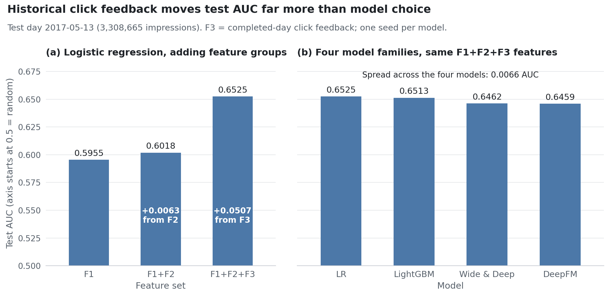
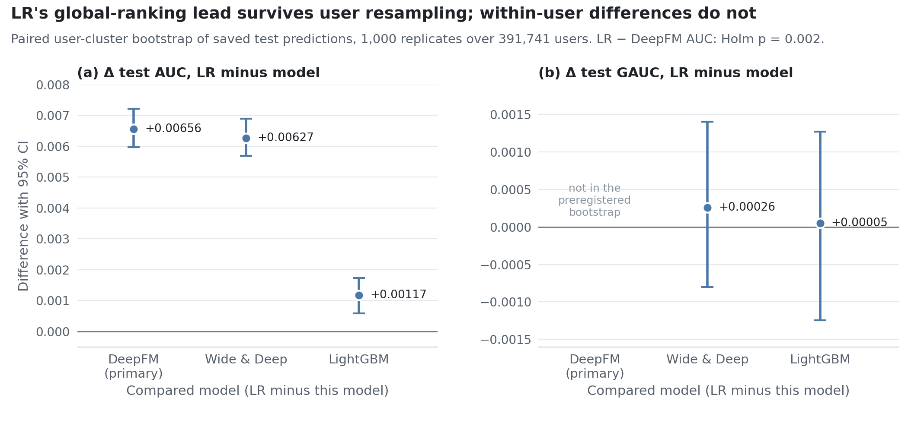
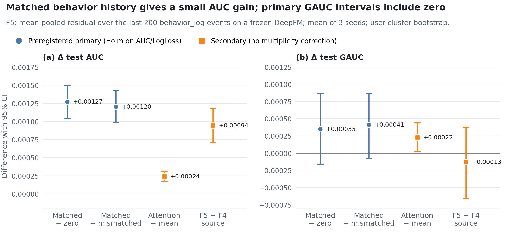
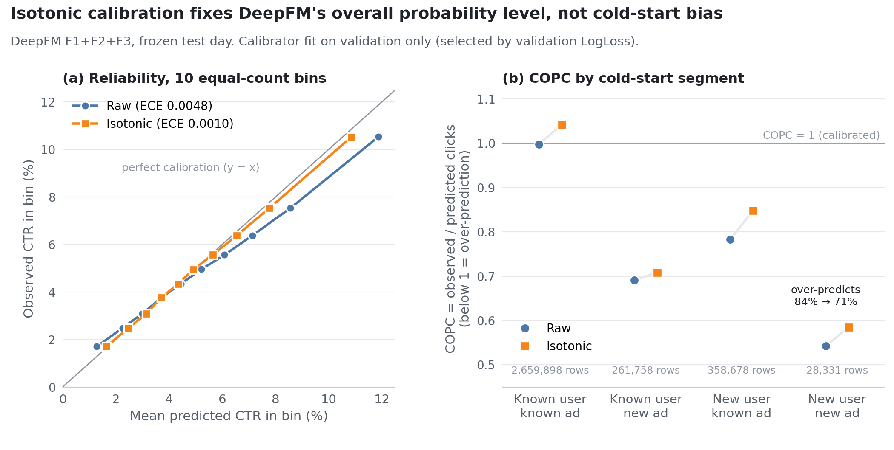
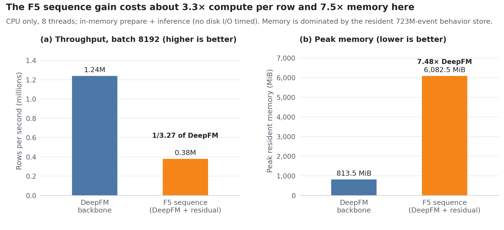

# Point-in-Time CTR Prediction on Taobao Display Ads

**Does richer historical information or a more complex model matter more for click-through-rate prediction?**
This project answers that on the public Alimama/Taobao display-advertising dataset (26,557,961 ad
impressions over eight days, plus 723 million user-behavior events) under a strict point-in-time
protocol: chronological train / validation / test days, features built only from days that were
complete before each impression, and every vocabulary, scaler and calibrator fit without test data.
Adding completed-day click feedback (F3) raised logistic-regression test AUC by **+0.0507**, about
eight times the gain from behavior aggregates (+0.0063) and far more than the **0.0066** AUC spread
across four model families trained on the same features. Logistic regression ranked first at equal
features (LR − DeepFM +0.00656 AUC, 95% user-cluster bootstrap CI [+0.00596, +0.00721], Holm
p = 0.002). A 200-event behavior-sequence model on a frozen DeepFM added a small, interval-supported
**+0.00127** AUC that mostly disappears when each user's history is swapped for another user's, at
about 3.3× the per-row compute and 7.5× the memory. All results are offline, on one held-out day.



| Question | Answer on the test day (2017-05-13) | Source |
|---|---|---|
| What drives accuracy? | Completed-day click feedback: LR AUC +0.0507 from F3 vs +0.0063 from F2 | [`results/lr_f1*/evaluation/`](results/lr_f1_f2_f3/evaluation/overall_metrics.csv) |
| Does a deeper model help at equal features? | No. LR > LightGBM > Wide & Deep > DeepFM on AUC; LR − DeepFM survives user resampling | [`frozen_model_bootstrap_v1`](results/frozen_model_bootstrap_v1/bootstrap_intervals.csv) |
| Do user behavior sequences help? | A little: +0.00127 AUC over no history; primary GAUC intervals include zero | [`f5_sequence_test_v1`](results/f5_sequence_test_v1/bootstrap_intervals.csv) |
| Are probabilities calibrated? | Isotonic cuts DeepFM ECE by 78%, but new-user × new-ad traffic is still over-predicted by 71% | [`deepfm_f1_f2_f3/calibration/`](results/deepfm_f1_f2_f3/calibration/evaluation/overall_metrics.csv) |
| What does the sequence gain cost? | 1/3.27 of DeepFM's throughput and 7.48× its peak memory in this implementation | [`serving_benchmark_v1`](results/serving_benchmark_v1/serving_benchmark.csv) |

Full write-up: [English final report](docs/FINAL_REPORT.md) ·
[中文报告 (PDF)](docs/FINAL_REPORT_ZH.pdf) / [中文文本](docs/FINAL_REPORT_ZH.md)

## Results

### 1. Information versus model complexity

| Model | Features | Test AUC | Test LogLoss | Test GAUC |
|---|---|---:|---:|---:|
| Logistic regression | F1 | 0.595495 | 0.196781 | 0.561913 |
| Logistic regression | F1+F2 | 0.601790 | 0.196376 | 0.561534 |
| **Logistic regression** | **F1+F2+F3** | **0.652489** | **0.192429** | 0.569939 |
| LightGBM | F1+F2+F3 | 0.651318 | 0.192502 | 0.569889 |
| Wide & Deep | F1+F2+F3 | 0.646219 | 0.193161 | 0.569680 |
| DeepFM | F1+F2+F3 | 0.645933 | 0.193176 | 0.569902 |

*Source:* test rows of `results/<run>/evaluation/overall_metrics.csv` and `gauc_summary.csv` for runs
`lr_f1`, `lr_f1_f2`, `lr_f1_f2_f3`, `lightgbm_f1_f2_f3`, `wide_deep_f1_f2_f3`, `deepfm_f1_f2_f3`;
[final report, "Information gain versus architecture gain"](docs/FINAL_REPORT.md#information-gain-versus-architecture-gain).

- The feature-group ablation was **retrained on logistic regression only**. LightGBM, Wide & Deep and
  DeepFM were trained once, at F1+F2+F3, so the model comparison is at equal features, not a full grid.
- Each tabular model is a single frozen seed (42). The three LR runs share optimizer settings and
  validation early stopping but stopped at different epochs (3, 3, 2).
- GAUC is the impression-weighted per-user AUC over the 104,884 test users with both a click and a
  non-click (50.84% of test impressions). F2 raised global AUC but not GAUC.

### 2. Is the logistic-regression lead real?

Paired user-cluster bootstrap of the saved test predictions (1,000 replicates; whole users resampled).
LR − DeepFM was the single preregistered primary comparison; the others are exploratory.

| Comparison | Metric | Effect | 95% CI | Note |
|---|---|---:|---|---|
| LR − DeepFM | AUC | +0.00655565 | [+0.00596489, +0.00721123] | primary, Holm p = 0.001998 |
| LR − DeepFM | LogLoss | −0.00074793 | [−0.00083617, −0.00067152] | primary, Holm p = 0.001998 |
| LR − Wide & Deep | AUC | +0.00626926 | [+0.00568570, +0.00689256] | excludes 0 |
| LR − LightGBM | AUC | +0.00117059 | [+0.00059116, +0.00173101] | excludes 0 |
| LR − LightGBM | LogLoss | −0.00007366 | [−0.00014903, +0.00000767] | includes 0 |
| LR − Wide & Deep | GAUC | +0.00025893 | [−0.00079951, +0.00140635] | includes 0 |
| LR − LightGBM | GAUC | +0.00004970 | [−0.00124507, +0.00127498] | includes 0 |

*Source:* [`results/frozen_model_bootstrap_v1/bootstrap_intervals.csv`](results/frozen_model_bootstrap_v1/bootstrap_intervals.csv)
(protocol committed before any interval was computed); [FROZEN_MODEL_BOOTSTRAP.md](docs/FROZEN_MODEL_BOOTSTRAP.md).



LR's global-ranking lead over the two neural models holds under user resampling. Against LightGBM it is
a ranking difference only (the LogLoss interval includes zero). The two GAUC differences that were
bootstrapped include zero; LR − DeepFM GAUC was not in the preregistered set. These intervals describe
user-sampling uncertainty for fixed, single-seed models, not retraining uncertainty.

### 3. User behavior sequences (F4, F5)

Two sequence sources were added as small residual models on top of the **frozen** seed-42 DeepFM
(F1+F2+F3). Mean ± standard deviation over three residual seeds (42, 2026, 3407) on that one backbone:

| Condition | Test AUC | Test LogLoss | Test GAUC |
|---|---:|---:|---:|
| Zero history (= the frozen DeepFM) | 0.645933 ± 0 | 0.193176 ± 0 | 0.569902 ± 0 |
| F5, mean pooling, mismatched history | 0.646003 ± 0.000128 | 0.193153 ± 0.000011 | 0.569840 ± 0.000063 |
| F4 clicked-ad, mean matched | 0.646263 ± 0.000044 | 0.193120 ± 0.000004 | 0.570380 ± 0.000108 |
| **F5 behavior, mean matched (primary)** | **0.647206 ± 0.000060** | **0.193061 ± 0.000031** | 0.570251 ± 0.000239 |
| F5 behavior, attention matched | 0.647445 ± 0.000077 | 0.193043 ± 0.000029 | 0.570476 ± 0.000054 |

| # | Contrast (paired user-cluster bootstrap) | Δ AUC [95% CI] | Δ GAUC [95% CI] |
|---|---|---|---|
| 1 | F5 mean matched − zero (primary) | **+0.00127246** [+0.00104340, +0.00150052] | +0.00034899 [−0.00016254, +0.00085982] |
| 2 | F5 mean matched − mismatched (primary) | **+0.00120269** [+0.00098519, +0.00142260] | +0.00041059 [−0.00008260, +0.00086338] |
| 5 | Attention − mean pooling, both matched | +0.00023967 [+0.00017050, +0.00031038] | +0.00022483 [+0.00001678, +0.00043734] |
| 6 | F5 mean matched − F4 mean matched | +0.00094211 [+0.00070402, +0.00118202] | −0.00012937 [−0.00066206, +0.00037694] |

*Source:* [`results/f5_sequence_test_v1/test_seed_summary.csv`](results/f5_sequence_test_v1/test_seed_summary.csv),
[`bootstrap_intervals.csv`](results/f5_sequence_test_v1/bootstrap_intervals.csv);
[F5_BEHAVIOR_TEST_RESULTS.md](docs/F5_BEHAVIOR_TEST_RESULTS.md). Holm correction covers the two primary
contrasts on AUC and LogLoss (four hypotheses, adjusted p = 0.003996 each); contrasts 3–6 are secondary.



- **Small and AUC-only.** Matched behavior history beats both no history and another user's history on
  AUC and LogLoss, and all three seeds agree. The primary GAUC intervals include zero, so a within-user
  ranking gain is not established.
- **Most of the gain is user-specific under this control.** The mismatched control recovers only
  +0.00007 of the +0.00127 (about 5.5%). The control is a deterministic different-user donor, not a
  strict permutation (details under [Limitations](#limitations)).
- **Attention barely helps.** Attention − mean is +0.00024 AUC; its GAUC interval excludes zero, but
  that is exploratory GAUC evidence without family-wise correction. Mean pooling stays the
  preregistered primary model.
- **The richer source matters.** F4 (last 20 clicked-ad categories; test mean 4.69 tokens, 30.21% of
  impressions empty) gave mean matched − zero +0.000330 AUC [+0.000216, +0.000440]
  ([`sequence_posthoc_v1`](results/sequence_posthoc_v1/bootstrap_intervals.csv)). F5 (last 200
  `behavior_log` events; mean 185.19 tokens, 0.4351% empty) roughly quadruples that gain.
- **LR still leads on global AUC.** F5 closes about 19.4% of the LR − DeepFM AUC gap (0.006556 →
  0.005283). On GAUC the order reverses (F5 0.570251 vs LR 0.569939), with no interval for that contrast.

### 4. Probability calibration (DeepFM)

| DeepFM F1+F2+F3, test day | Raw | Isotonic |
|---|---:|---:|
| ECE (10 equal-count bins) | 0.004795 | 0.001049 (−78%) |
| COPC = observed / predicted clicks (1 is ideal) | 0.940 | 0.986 |
| LogLoss | 0.193176 | 0.192876 |
| New user × new ad (28,331 rows): predicted / observed clicks − 1 | +84.2% | +71.0% |

*Source:* `results/deepfm_f1_f2_f3/evaluation/` (raw) and
[`results/deepfm_f1_f2_f3/calibration/evaluation/`](results/deepfm_f1_f2_f3/calibration/evaluation/cold_start_metrics.csv)
(isotonic), files `overall_metrics.csv`, `cold_start_metrics.csv`, `reliability_bins.csv`. The
calibration-selection diagnostic in `calibration/test_metrics.csv` uses 20 equal-width bins and gives
ECE 0.004495 → 0.000985, the same 78% reduction.



The calibrator (isotonic, chosen over Platt scaling by validation LogLoss) was fit on validation only
and applied once to test. It fixes the overall probability level but not group-level bias: new-user and
new-ad segments remain over-predicted, while known-user × known-ad moves to slight under-prediction
(COPC 0.998 → 1.042). Isotonic regression creates ties, so ranking metrics can move either way; here
AUC fell slightly (0.645933 → 0.645879).

### 5. Serving cost

| Model | Pure model call, rows/s @8192 | In-memory prepare + inference, rows/s @8192 | Peak RSS (MiB) |
|---|---:|---:|---:|
| Logistic regression F1+F2+F3 | 18,083,051 | 1,275,056 | 705.7 |
| DeepFM F1+F2+F3 | 1,530,445 | 1,239,580 | 813.5 |
| F5 mean matched (DeepFM + residual) | 658,608 | 379,078 | 6,082.5 |
| **F5 relative to DeepFM** | **1/2.32** | **1/3.27** | **7.48×** |

*Source:* [`results/serving_benchmark_v1/serving_benchmark.csv`](results/serving_benchmark_v1/serving_benchmark.csv);
[SERVING_BENCHMARK.md](docs/SERVING_BENCHMARK.md). CPU only, 8 threads, one subprocess per model, a fixed
validation slice as input (labels unused).



"In-memory prepare + inference" times encoding, scaling, sequence gathering and the model call on a
batch already in memory; Parquet reading, decompression and deserialization happen before the timer
(the CSV columns `end_to_end_*` hold this regime). Cold-cache online latency with real disk I/O was not
measured. F5's memory comes from keeping the 723,113,323-event behavior store resident, not from its
57,345 residual parameters; streaming reads, memory mapping or a feature service would change it
without touching the model. LR's pure throughput is 14× its prepare + inference throughput because
building its 2,497,016-dimension sparse row dominates.

## Method

### Data and splits

Public "Ad Display/Click Data on Taobao.com" dataset from Alimama
([Tianchi dataset 56](https://tianchi.aliyun.com/dataset/56)): `raw_sample` (impressions with click
labels), `ad_feature`, `user_profile` and `behavior_log` (723,268,134 rows of pv / cart / fav / buy
events). All impressions are used, with no negative downsampling. Dates are Beijing time.

| Split | Dates | Impressions | CTR |
|---|---|---:|---:|
| Train | 2017-05-06 – 05-11 | 20,015,245 | 5.20% |
| Validation | 2017-05-12 | 3,234,051 | 4.93% |
| Test | 2017-05-13 | 3,308,665 | 5.03% |

*Source:* [`results/feature_profile/split_summary.csv`](results/feature_profile/split_summary.csv).

### Leakage controls

- **Train-only fitting.** Raw IDs are joined across tables before encoding; category vocabularies and
  numeric scalers are fit on the training split; unseen IDs map to a reserved UNKNOWN index.
- **Completed days only.** Every historical feature (F2–F5) uses Beijing dates strictly before the
  impression date. Validation never sees May 12 feedback; test may use the completed May 12.
- **Click time.** The data has no separate click timestamp, so the exposure time stands in for the
  click record time, and feedback is assumed available the next day.
- **First training day kept.** On 2017-05-06 no completed prior day exists, so F3 falls back to a fixed
  prior with `has_past_feedback = 0`; those 3,270,348 impressions (16.3% of training) were kept.
- **Usable behavior window.** `behavior_log` is used from 2017-04-22 to 2017-05-13 (99.9786% of
  events); 127,136 earlier events have sporadic or corrupt timestamps and are excluded.
- **Validation-only selection.** Hyperparameters, epochs, sequence settings and calibrators were chosen
  on validation. Each frozen sequence checkpoint was run on test exactly once, behind a once-only marker,
  under comparison plans committed before inference.

### Feature groups

| Group | Contents |
|---|---|
| F1 | Static and context fields: user, ad group, campaign, advertiser, brand and category IDs; placement; hour; user profile; price (weekday excluded) |
| F2 | User behavior aggregates: pv / cart / fav / buy counts over the last 1, 3, 7 and 14 completed days, plus recency |
| F3 | Completed-day click feedback: smoothed past CTR and past exposure counts for user, ad, category, campaign, advertiser and brand |
| F4 | Sequence: categories of the user's last 20 clicked ads |
| F5 | Sequence: the user's last 200 `behavior_log` events (category + behavior type) |

F5 categories outside the training ad-category vocabulary map to UNKNOWN (4.3029% of in-window events;
3.941954% of retained test tokens).

### Models

- **Logistic regression:** out-of-core SGD (`scikit-learn` `SGDClassifier.partial_fit`) on a
  2,497,016-dimension sparse one-hot plus dense design; epoch selected by validation LogLoss.
- **LightGBM:** native categorical splits, early stopping on validation (251 trees).
- **Wide & Deep, DeepFM:** PyTorch, embedding size 8, 22.5M parameters, trained on Apple MPS.
- **Sequence residuals (F4, F5):** a small additive residual (mean pooling or target attention over
  the history embeddings) on the frozen DeepFM; the F5 residual has 57,345 parameters. Controls: zero
  history (bit-identical to the backbone) and mismatched history from a different user with the same
  retained length and similar coarse activity and recency.

### Evaluation

- One shared evaluator for every model: AUC, LogLoss, PR-AUC, GAUC, COPC and ECE.
- **Uncertainty:** paired user-cluster bootstrap over saved test predictions (1,000 replicates; all
  391,741 test users as clusters; percentile 95% intervals; centered two-sided p-values with
  resolution 1/1001).
- **Multiplicity:** hypotheses and Holm scopes were committed before intervals were computed. Holm
  covers LR − DeepFM on AUC and LogLoss, and the two F5 primary contrasts on AUC and LogLoss. Every
  other contrast is reported uncorrected and labelled exploratory.
- **Seeds:** tabular models have one seed each. Sequence residuals use three seeds on one shared
  backbone, so seed spread and bootstrap intervals are separate quantities and are never merged.

### Deeper diagnostics

These come from saved predictions and validation-only checks (no retraining). See
[D2](docs/DEEP_DIVE_D2_RESULTS.md), [D3](docs/DEEP_DIVE_D3_RESULTS.md) and [D4](docs/DEEP_DIVE_D4_RESULTS.md).

- About 98.89% of the F4 mean-matched GAUC gain over zero history comes from known users.
- Neutralizing F3 in the frozen models hurts validation AUC more than neutralizing F2 (LR 0.655 →
  0.585 without F3, 0.644 without F2). This is a sensitivity check, not a retrained ablation.
- New-ID shares and history coverage shift between validation and test, and CTR falls with prior-day
  repeat exposure. Both are descriptive associations, not causal estimates.

## Limitations

- **Offline only.** There is no online A/B test. Results come from one held-out test day (2017-05-13),
  and the test day was inspected during early baseline development before the protocol was frozen. It
  is a frozen reporting set, not a never-seen holdout.
- **Single seeds for tabular models.** LR vs LightGBM / Wide & Deep / DeepFM carries user-sampling
  uncertainty but no retraining uncertainty.
- **Ablation on LR only.** Feature groups were not ablated for the other model families.
- **Sequence models are residuals on a frozen backbone,** not jointly trained DIN/DSIN models. F5
  changes the source, the length and the token schema at once, so their separate effects are not
  identified. The completed-day cutoff is deliberately conservative.
- **Calibration** was selected on an impression-level 80/20 validation split, not a user-grouped split,
  so its transfer to entirely new users is not measured.
- **Serving numbers** describe this implementation on one machine, without disk I/O in the timed path.

<details>
<summary>F5 mismatched control: donor reuse and residual imbalance</summary>

The mismatched control is a deterministic different-user donor assignment with a measured, roughly
0.08% user-level reuse deviation, not a strict one-to-one permutation. Donor reuse excess is
0.078109% of users on validation and 0.080850% on test. Impressions whose user received a reused donor
are 0.475843% (validation) and 0.388223% (test). Self-match, length, future-event and ordering
violations are zero. On validation, category total variation between matched and donor histories is
0.04982, and exposure-weighted past activity is 138.23 (matched) vs 87.72 (donor), so balance is
approximate. The "about 95% of the gain is user-specific" ratio is therefore descriptive, not a causal
attribution. Full tables: [F5_DONOR_UNIQUENESS_AUDIT.md](docs/F5_DONOR_UNIQUENESS_AUDIT.md).

</details>

## Repository structure

```text
src/                     pipeline scripts, numbered in execution order, plus shared modules
  01-12                  raw-data validation, base tables, F2/F3 features, encoding, shared evaluator
  13-18                  LR / LightGBM / Wide & Deep / DeepFM tuning, training, calibration
  19-32                  F4 sequences: build, audit, residual training, one-time test, bootstrap
  33-39                  saved-prediction diagnostics, report figures, delivery and release audits
  40-48                  behavior-log audit, frozen-model bootstrap, F5 sequences and training
  49-59                  serving benchmark, experiment registry, F5 test and analysis, audits
  make_readme_figures.py figures on this page (reads committed result CSVs only)
tests/                   unit tests on small synthetic fixtures
results/                 versioned metrics, manifests, bootstrap intervals and audits (CSV / JSON)
figures/readme/          figures on this page
figures/deep_dive_v1/    report figures (PNG + PDF)
docs/                    final reports and per-stage evidence documents
artifacts/encoders/      encoding manifest; models, predictions and data are local and Git-ignored
```

Stage documents: [experiment index](docs/EXPERIMENT_INDEX.md) (registry snapshot at the E6 release),
[behavior-log audit](docs/BEHAVIOR_NAMESPACE_AUDIT.md), [F4 test](docs/DIN_F4_TEST_RESULTS.md),
[F5 validation](docs/F5_BEHAVIOR_VALIDATION.md), [F5 test](docs/F5_BEHAVIOR_TEST_RESULTS.md),
[frozen-model bootstrap](docs/FROZEN_MODEL_BOOTSTRAP.md), [serving](docs/SERVING_BENCHMARK.md),
[release audit (中文)](docs/RELEASE_AUDIT.md).

## Reproducing

**From a clone (no data needed).** These read only the committed result files:

```bash
pip install -r requirements.txt             # tests and audits (exact versions: requirements-tested.txt)
pip install -r requirements-plot.txt        # figures
python src/make_readme_figures.py           # regenerates figures/readme/*.png
python -m unittest discover -s tests        # synthetic-fixture unit tests
python src/38_release_audit.py              # arithmetic and document checks on saved summaries
python src/58_audit_e1_e6_release.py
python src/59_audit_public_artifacts.py     # no personal paths or credentials in tracked files
```

**Full pipeline.** Download the four CSVs from the dataset page into `data/raw/`, install the exact
versions in `requirements-tested.txt` (Python 3.11), and run `src/01_…` onward in numeric order from the
repository root. The pipeline was built for one audited run rather than push-button reruns: completed
stages refuse to overwrite their results, the one-time test stages refuse to run a second time, and the
later formal stages (`src/40`–`src/56`) refuse to run if installed versions differ from
`requirements-tested.txt`. Large data, models and predictions are Git-ignored; `src/37_verify_frozen_delivery.py`
checks their hashes when they are present locally. Details: [RELEASE_AUDIT.md](docs/RELEASE_AUDIT.md).
