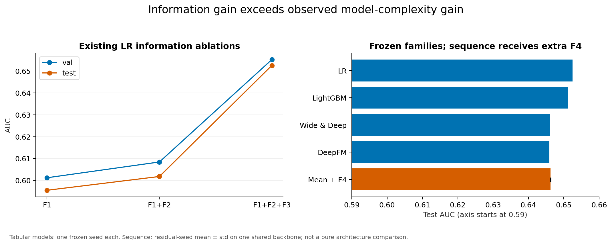
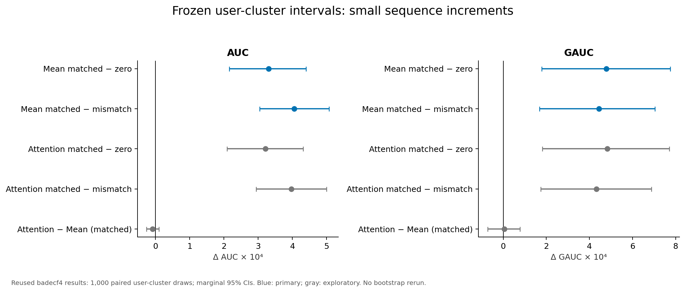
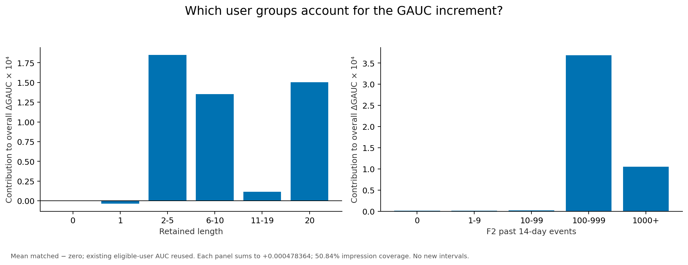
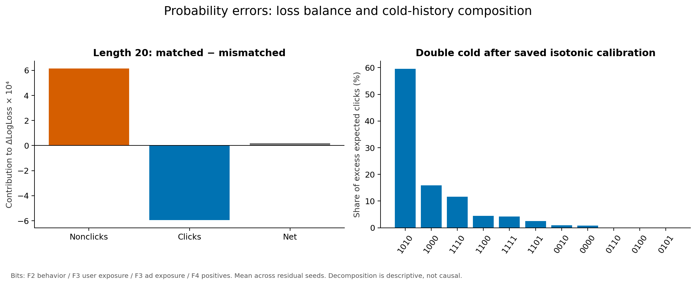
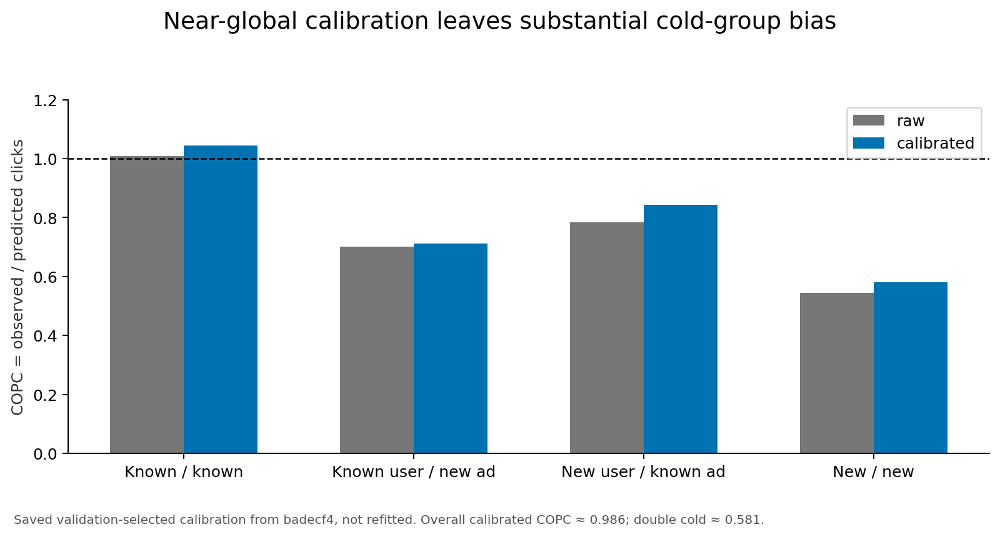
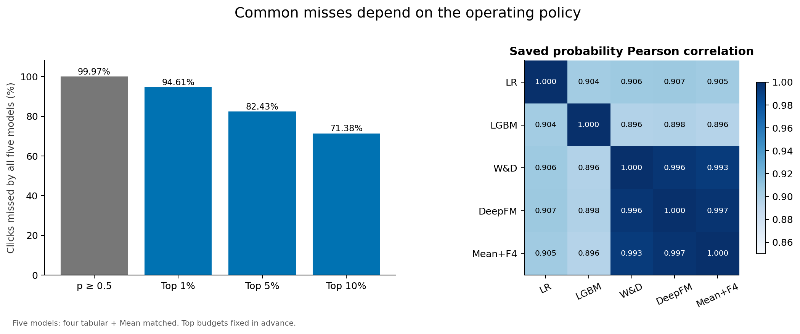
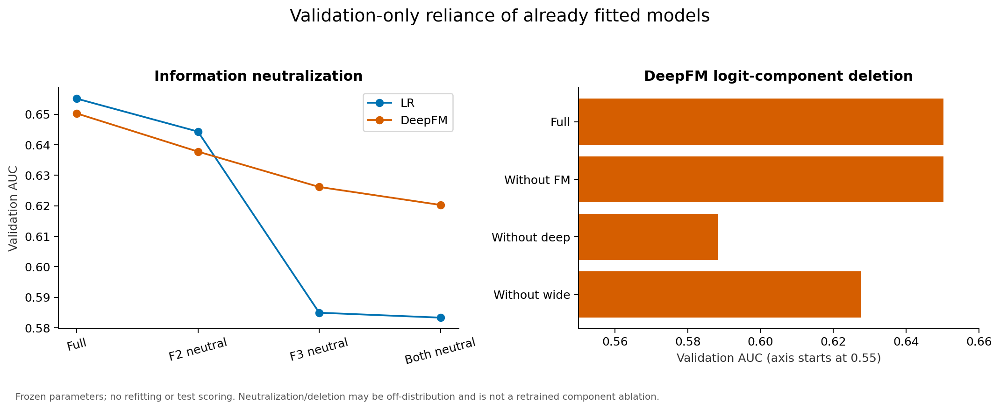
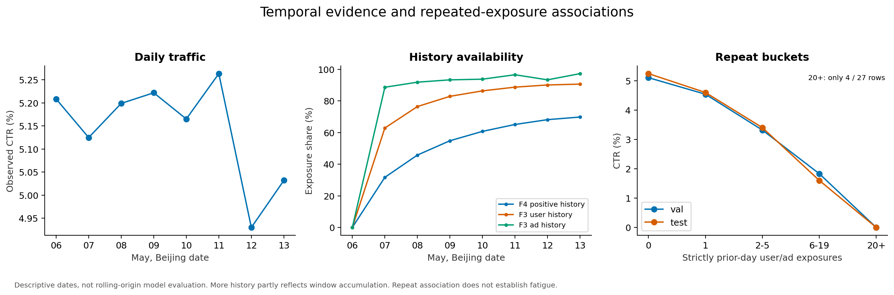

# Historical information, complexity and robustness in point-in-time CTR prediction

## Summary

**The strongest formal model on global ranking is still logistic regression.** LR
F1+F2+F3 reaches test AUC **0.652489**; no model in this study beats it.

- **Historical feedback, not model complexity, is the main source of performance.**
  F3 completed-day click feedback raises LR test AUC from **0.601790** (F1+F2) to
  **0.652489** (F1+F2+F3), **+0.05070**, against **+0.00630** for the F2 behavior
  aggregates. At the common F1+F2+F3 budget LR − DeepFM AUC is **+0.00655565**,
  95% CI [+0.00596489, +0.00721123], Holm p = 0.001998.
- **F5, the `behavior_log` sequence budget, improves on the frozen null.**
  Mean matched − zero is **+0.00127246 AUC**, 95% CI
  [+0.00104340, +0.00150052], Holm p = 0.003996.
- **It exceeds the sparse F4 clicked-ad source on global ranking**, by
  **+0.00094211 AUC**, 95% CI [+0.00070402, +0.00118202] — but their **GAUC
  difference is not established** (−0.00012937, interval spans zero, p = 0.621).
- **Matched exceeds the implemented different-user donor control.** Matched − mismatched is
  **+0.00120269 AUC**, 95% CI [+0.00098519, +0.00142260], Holm p = 0.003996. Since
  mismatched − zero is only +0.00007, it retains about **5.5%** of the AUC gap.
  Under this implemented control, matched-minus-mismatched accounts for about
  **95%** of matched-minus-zero: a descriptive ratio, not causal identity attribution.
- **Attention beats mean pooling only slightly.** Attention − mean is
  **+0.00023967 AUC**, 95% CI [+0.00017050, +0.00031038] — an interval that
  excludes zero for the first time, unlike the F4 study — but the effect is about
  one fifth of the matched-minus-mismatched effect and roughly two seed standard deviations.
  **Mean matched remains the preregistered primary model**; the test did not and
  cannot change that.
- **F5 narrows the LR gap without closing it.** The global AUC gap from LR to the
  frozen DeepFM null was 0.006556; F5 reduces it to 0.005283, closing about
  **19.4%**. LR still leads by roughly four times the entire F5 sequence effect.
  On GAUC the ordering reverses, F5 reaching 0.570251 against LR's 0.569939.
- **The current F5 implementation has no deployment advantage.** Its in-memory prepare + inference
  throughput is **1/3.27** of the DeepFM backbone it sits on (379,078 against
  1,239,580 rows/s at batch 8192), so its per-row compute cost is about **3.27×**,
  and its peak memory is **7.48×** (6,082 against 813 MiB). That memory is the
  resident 723,113,323-event store, **not** the residual's 57,345 parameters.
- **Calibration fixes the overall probability level, not group-level bias.**
  Calibrated F4 mean matched reaches overall COPC **0.986**, while double cold
  start sits at **0.581**, i.e. predicted clicks run about **72% above** observed.

Two sequence sources were tested: past clicked-ad categories (F4, test mean 4.69
retained tokens, 30.21% empty) and `behavior_log` category-plus-type events (F5,
test mean 185.19 tokens, 0.4351% empty). **The result is not "DIN wins."** The
richer source produces a larger but still small global-ranking gain at higher serving
cost. The preregistered mean-pooling primary comparison did not establish a GAUC
gain; attention-based secondary comparisons showed nominal exploratory GAUC
evidence without family-wise correction for that metric.

## F5 control clarification and remaining imbalance

The control is a **deterministic different-user donor assignment with a measured
approximately 0.08% user-level reuse deviation**, not a strict one-to-one
permutation. Validation reuse excess is **884 / 1,131,745 (0.078109%)**; test is
**917 / 1,134,206 (0.080850%)**. Reused donors number **869 / 911**, with maximum
indegree **4 / 3**. Targets assigned reused donors number **1,753 / 1,828**;
**575 / 562** appear in that day's exposures, covering **15,389 (0.475843%)** /
**12,845 (0.388223%)** impressions. Self-match, length, future-event, ownership
and order violations remain zero. Small reuse does not establish negligible
metric impact; no retrained strict-derangement counterfactual exists.

The saved validation control has category TV **0.04982**, age **3.75 vs 4.08 days**,
and exposure-weighted past activity **138.23 vs 87.72**. Retained length is exact
and coarse activity/recency buckets nearly match. User-level balance does not
imply exposure-level balance. The activity gap is residual exposure-weighted,
within-bucket imbalance; it is not simply attributable to donor reuse.
Under this implemented control, the approximately **95%** AUC gap ratio is
descriptive, not causal identity attribution. Full date/indegree/partition tables:
[F5 donor audit](F5_DONOR_UNIQUENESS_AUDIT.md).

## F5: the behavior-sequence budget

A second sequence source was built and tested once, under rules committed before
the pass. Where F4 retains a mean of 4.69 clicked-ad category tokens with 30.21% of
test impressions empty, F5 retains 185.19 `behavior_log` tokens with 0.435% empty.
Both sit on the same frozen DeepFM backbone.

| Condition | Test AUC ± std | Test LogLoss ± std | Test GAUC ± std |
|---|---|---|---|
| F5 attention matched | 0.647445 ± 7.7e-5 | 0.193043 ± 2.9e-5 | 0.570476 ± 5.4e-5 |
| **F5 mean matched** | 0.647206 ± 6.0e-5 | 0.193061 ± 3.1e-5 | 0.570251 ± 2.4e-4 |
| F4 mean matched | 0.646263 ± 4.4e-5 | 0.193120 ± 3.8e-6 | 0.570380 ± 1.1e-4 |
| F5 mean mismatched | 0.646003 ± 1.3e-4 | 0.193153 ± 1.1e-5 | 0.569840 ± 6.3e-5 |
| zero pipeline null | 0.645933 ± 0 | 0.193176 ± 0 | 0.569902 ± 0 |

Both primary comparisons exclude zero at Holm p = 0.003996: mean matched − zero
AUC +0.00127246 CI [+0.00104340, +0.00150052], and mean matched − mismatched AUC
+0.00120269 CI [+0.00098519, +0.00142260]. The mismatch control captures only about
**5.5%** of the AUC gap. Under the implemented different-user donor control,
matched-minus-mismatched accounts for about **95%** of matched-minus-zero.
This is descriptive, not a causal contribution rate; residual imbalance remains. All twelve
primary-and-secondary AUC/LogLoss pairs favour the left condition in all three
seeds.

Three findings qualify the picture. **Global and within-user ranking disagree**: F5 mean
beats both the null and F4 on AUC, yet its GAUC intervals against both include zero
(p = 0.172 and p = 0.621). **The gain lands where the sparse source was empty**: on
the 985,688 test impressions with no clicked-ad history but a nonempty behavior history, F5 − zero is +0.001607
against +0.001163 where both sources have history, and it is **negative on double
cold start** (−0.001741 on 28,331 rows, no interval). **The saved bucket-relaxation sensitivity is small**: excluding all 1,457 relaxed rows moves matched − mismatched by at most
9.0e-7 on AUC with every sign preserved.

F5 closes about **19.4%** of the global AUC gap between LR F123 (0.652489) and the
frozen null, leaving LR ahead by roughly four times the entire F5 effect. On GAUC the
ordering reverses, F5 reaching 0.570251 against LR's 0.569939 — consistent with the
frozen-model bootstrap, where both bootstrapped tabular GAUC differences
(LR − LightGBM, LR − Wide & Deep) also included zero.

Full evidence and limits: [F5 validation and freeze](F5_BEHAVIOR_VALIDATION.md),
[F5 formal test results](F5_BEHAVIOR_TEST_RESULTS.md),
[serving benchmark](SERVING_BENCHMARK.md), [experiment index](EXPERIMENT_INDEX.md).

## Result and scope

Under the audited temporal protocol and observed tuning budget, past click-feedback
information provides a much larger gain than the tested increases in model
complexity. User-matched **past clicked-ad category** histories add a small,
statistically detectable increment to a frozen DeepFM. On that representation —
retained length 20, test mean 4.69 tokens, 30.21% of test impressions empty —
target attention has no robust practical advantage over mean pooling. These
sequence statements are scoped to the clicked-ad category source and are **not**
transferred to full `behavior_log` `pv/cart/fav/buy` sequences, nor to sequence
modeling or DIN in general. Sequence benefits are uneven across history and user
groups, while probability bias persists under cold start and changing traffic.

This is a conditional empirical conclusion, not a universal claim that linear
models are better or that drift causes every generalization gap. The core statistical
evidence is frozen at **badecf4** in [DIN_F4_TEST_RESULTS.md](DIN_F4_TEST_RESULTS.md).
D2–D5 reuse it without new bootstrap, calibration fitting, CTR training or test
inference. The [deep-dive plan](DEEP_DIVE_RESEARCH_PLAN.md) was committed in
**e494030** before the new grouped findings, after aggregate test outcomes were known.

## Data and leakage controls

The study uses all 26,557,961 impressions, with no negative downsampling. Beijing
dates May 6–11 are training (20,015,245), May 12 validation (3,234,051), and May 13
frozen test reporting (3,308,665). Raw IDs join source tables before encoding;
vocabularies/scalers fit training only. Historical features use completed days
strictly before the exposure date. Test may use finished May 12 feedback, validation
may not. Positive exposure timestamps proxy feedback record time, with next-day
availability assumed; independent click timestamps are not observed.

F1 is static/context, excluding weekday in formal models. F2 summarizes past
behavior. F3 supplies smoothed entity feedback and evidence counts; on the first
training date, 2017-05-06, no completed prior date exists inside the impression
window, so all entity histories fall back to the fixed prior with
`has_past_feedback = 0`, and those 3,270,348 impressions (16.3% of training) were
retained rather than dropped. The behavior log's usable window is 2017-04-22
through 2017-05-13, 22 dates carrying 99.9786% of events; earlier timestamps are
sporadic or corrupt (127,136 events over 653 dates), so the effective
pre-impression history is 14 completed days before 2017-05-06. F4 retains
the ordered last 20 positive-exposure categories, with train-only vocabulary,
neutral PAD/UNKNOWN and zero empty-history representations. The mismatch control
preserves cutoff, retained length and coarse activity while exchanging user
history; it does not exactly balance all popularity/age/activity effects.

## Metric definitions and directions

AUC, PR-AUC and GAUC: higher is better. LogLoss, Brier score and ECE: lower is
better. COPC = observed clicks / predicted clicks = CTR / mean prediction;
1 is ideal, <1 indicates overprediction and >1 underprediction. A difference
in COPC is not inherently a gain. A COPC of 0.581 means predicted clicks exceed
observed clicks by about 72% (`1/0.581 − 1`), which is a different quantity from
the 42% shortfall of observed against predicted (`1 − 0.581`). Shared reporting uses 10 equal-count ECE bins;
legacy calibration selection records a separate 20 equal-width diagnostic.
Seed std uses ddof=1; bootstrap CIs describe user sampling conditional on fixed
models. Undefined single-class AUC remains missing, never replaced with zero.

## Information gain versus architecture gain

The existing LR test AUC increases from 0.595495 (F1) to 0.601790 (F12), then
0.652489 (F123). The F3 increment is about **0.05070 AUC**, versus F2's 0.00630.
These runs share optimizer settings and validation stopping, but selected epochs
differ (3, 3, 2); they are not identical fixed-epoch fits. At common F123 input,
the saved LR and LightGBM outperform the two tabular neural models globally.
F2's global AUC increase does not imply a within-user increase: the saved LR
test GAUC is 0.561913 for F1 and 0.561534 for F12, before rising to 0.569939 for
F123. Refit coefficients can change between these trained runs; this comparison
is distinct from D3's fixed-parameter F2 deletion.

| Frozen model | Raw test AUC | Raw LogLoss | GAUC |
|---|---:|---:|---:|
| LR F123 | 0.652489 | 0.192429 | 0.569939 |
| LightGBM F123 | 0.651318 | 0.192502 | 0.569889 |
| Wide & Deep F123 | 0.646219 | 0.193161 | 0.569680 |
| DeepFM F123 / zero | 0.645933 | 0.193176 | 0.569902 |
| Mean matched F123+F4 | 0.646263 ± 0.000044 | 0.193120 ± 0.000004 | 0.570380 ± 0.000108 |

Tabular rows represent one seed each; the sequence row represents three residual
seeds on one shared backbone. Its richer F4 input prevents a pure architecture
interpretation.

A paired user-cluster bootstrap over these saved predictions (1,000 replicates,
seed 20260926, preregistered in `29659c3`) now attaches intervals to the tabular
ordering:

| Comparison | Metric | Effect | 95% CI | Excludes 0 |
|---|---|---:|---|:--:|
| LR − DeepFM (primary) | AUC | +0.00655565 | [+0.00596489, +0.00721123] | yes |
| LR − DeepFM (primary) | LogLoss | −0.00074793 | [−0.00083617, −0.00067152] | yes |
| LR − LightGBM | AUC | +0.00117059 | [+0.00059116, +0.00173101] | yes |
| LR − LightGBM | LogLoss | −0.00007366 | [−0.00014903, +0.00000767] | **no** |
| LR − LightGBM | GAUC | +0.00004970 | [−0.00124507, +0.00127498] | **no** |
| LR − Wide & Deep | GAUC | +0.00025893 | [−0.00079951, +0.00140635] | **no** |

Holm correction covers only the two primary metrics (p = 0.001998 for both).
Intervals are conditional on the frozen fitted models and this single test day;
they estimate user-sampling uncertainty and **not** training-seed uncertainty,
because each family has one seed. Two results matter for the narrative: LR's
global ranking advantage over both neural families survives user resampling,
while **both bootstrapped GAUC differences (LR − LightGBM, LR − Wide & Deep)
include zero** (LR − DeepFM GAUC was not in the preregistered set), so that
advantage is not shown to transfer to within-user ranking. LR over LightGBM is a ranking difference, not a
probability-quality difference. Details and limits in
[FROZEN_MODEL_BOOTSTRAP.md](FROZEN_MODEL_BOOTSTRAP.md). GAUC evaluates only 104,884 users with both labels, covering 50.84%
of test exposures; global AUC evaluates all exposures and cross-user pairs.

## Published Alimama results as background, not as a reproduction

The DSIN paper ([arXiv:1905.06482](https://arxiv.org/abs/1905.06482), IJCAI 2019)
reports on the same public advertising dataset with the same test day (2017-05-13;
DSIN trains on May 6–12, while this project holds out May 12 for validation) and
the users' most recent 200 `behavior_log` events: YoutubeNet without user
behavior 0.6239, YoutubeNet with average pooling 0.6313, Wide & Deep 0.6326,
DIN 0.6330, DIEN 0.6343, DSIN 0.6375.

Within that table, introducing a user behavior sequence corresponds to about
**+0.0074** AUC (0.6313 − 0.6239) and DIN over the average-pooling model to about
**+0.0017** (0.6330 − 0.6313). This project observes **+0.00033** and
**−0.0000086** for the analogous contrasts on a mean-4.69-token clicked-ad
category sequence.

The sequence source, split, feature budget, backbone and training procedure all
differ, so this is background context and **not** a direct reproduction. Those
published values are single reported point estimates and are not described here
as significant. The roughly 22-fold gap on the sequence-presence contrast is
consistent with the source and its information density limiting the observed F4
effect; that is the hypothesis F5 tests, not a conclusion already established.

## Controlled sequence evidence

The five frozen comparisons remain in their original order. Below are their
existing raw point effects; full four-metric intervals and p-values are in the
immutable DIN report and [bootstrap table](../results/sequence_posthoc_v1/bootstrap_intervals.csv).

| Priority | Left − right | ΔAUC | ΔLogLoss |
|---|---|---:|---:|
| Primary 1 | Mean matched − zero | +0.000330347 | −0.000056164 |
| Primary 2 | Mean matched − mean mismatched | +0.000405708 | −0.000030542 |
| Secondary 3 | Attention matched − zero | +0.000321725 | −0.000058000 |
| Secondary 4 | Attention matched − attention mismatched | +0.000397302 | −0.000032132 |
| Secondary 5 | Attention matched − Mean matched | −0.000008622 | −0.000001836 |

The two primary AUC/LogLoss contrasts pass Holm (joint four-hypothesis p=0.003996).
The 1,000 paired user-cluster draws quantify sampling uncertainty conditional on
the fixed models/day, not independent training uncertainty. All three residual
seeds favor matched over mismatched on AUC, LogLoss, PR-AUC and GAUC. Zero is one
deterministic predictor, not three independent seeds.

Attention-minus-mean AUC/PR-AUC/GAUC intervals include zero. The tiny LogLoss
percentile interval is just below zero, but the predeclared centered p=0.064935;
these statistics are not inverses. Both are retained. This exploratory, practically
tiny result does not justify replacing the preselected Mean matched model.

## What the deeper sequence and population analysis adds

At retained length 20, matched beats mismatched in AUC by +0.000474273 but loses
in LogLoss by +0.000019789. Nonclick loss contributes about +0.000615, versus
−0.000595 from clicks: upward probability changes help clicks but slightly hurt
the much larger nonclick group more. Raw histories >=50 account for 58.64% of
the net loss worsening. This explains the arithmetic, not a causal effect of
truncation. Matched still beats zero in capped-group LogLoss.

Of Mean matched's +0.000478364 GAUC increment over zero, about **98.89% comes from
known users**. Lengths 2–5, 6–10 and capped 20 contribute most; length 1 contributes
slightly negatively and empty histories exactly zero. Contributions use existing
whole-user AUCs with the original exposure weights and sum to the frozen total.
They combine group size with group effect, rather than ranking groups by intrinsic
sequence usefulness. No new subgroup significance tests were performed.

Global-ranking model order remains different. In every fixed F2 activity bucket,
LR has higher AUC than Mean matched, even though high-activity users account for
most sequence-versus-zero GAUC improvement:

| F2 past-14-day events | Test exposures | LR AUC | Mean matched AUC |
|---|---:|---:|---:|
| 0 | 20,799 | 0.586027 | 0.582605 |
| 1–9 | 30,092 | 0.604783 | 0.601617 |
| 10–99 | 335,026 | 0.637135 | 0.630867 |
| 100–999 | 2,236,989 | 0.652585 | 0.646121 |
| >=1000 | 685,759 | 0.655510 | 0.651809 |

LR also leads in all age codes 1–6 and missing-profile-age rows. The small code-0
cell (1,186 exposures) reverses that point ordering; it is not evidence for
demographic routing. All original gender/age/value/shopping codes, profile presence,
placement, fixed hour blocks and evidence strata remain in the
[D2 group tables](../results/deep_dive_d2_v1/group_summary.csv), including sparse
and single-class cells. No supplied demographic code is relabeled as an inferred
identity or treated as a causal driver.

## Cold vocabulary is not absence of historical information

Mean matched's previously calibrated overall COPC is 0.986346, yet double cold
is 0.581043: 1,024 clicks versus approximately 1,762 expected clicks in 28,331
exposures. A large cell with F2 behavior and F3 ad evidence, but no F3 user
exposures/F4 positive history, accounts for **59.54% of excess expected clicks**.
The cell with none of these four evidence sources accounts for only **0.82%**.
Unknown train IDs can have newly accumulated May 12 feedback; “cold” and “empty”
therefore describe different mechanisms.

These are expected-click accounting shares, not averaged subgroup ratios or
identified causes. Profile/history/evidence-strength partitions all reconcile to
the same total. The saved global isotonic calibration improves LogLoss/ECE and in
these saved results reduces AUC, PR-AUC and GAUC. The mechanism is tie creation:
isotonic regression is a monotone non-decreasing step function, so it introduces
no new inversions, but collapsing distinct scores onto one step turns strict
orderings into ties. Because a tie can replace either a correctly or an
incorrectly ordered pair, ranking metrics **can move in either direction**; the
observed decrease is an empirical outcome, not an arithmetic necessity. Its step
boundaries come from PAVA, so there is no bin-count hyperparameter to tune;
`ece_bins=20` belongs to the ECE reliability diagnostic. Calibration neither
solves group bias nor establishes that group-specific calibration would improve
unseen future traffic.

## Audit of common misses and model complementarity

The archived “60% missed by every model” source uses **top-10% quantiles**, not
p>=0.5. Its original arrays are absent, so the exact number is unverifiable.
The script also skips missing models and lacks ID-based array alignment. It must
not be merged numerically with this rebuilt 3.31M-exposure test cohort.

Here five-model common misses are 71.38% at an exact **top-10% exposure budget per model** and 99.97% at
p>=0.5. The top-10% union reaches 28.62% recall at **14.61% exposure coverage**,
so it is not an equal-budget ensemble gain. Known/known traffic supplies most
absolute common misses; new-user/known-ad traffic actually has a lower within-
group common-miss rate than known/known. The original broad cold-user claim is
not transferred into the new narrative.

Neural scores are strongly correlated: Mean matched/DeepFM Pearson≈0.99734 and
Wide & Deep/DeepFM≈0.99590. Pairwise error overlap and Spearman/residual correlation
are also saved. A true-label-informed minimum-loss oracle attains approximately
0.178235 versus LR's 0.192429, but requires labels to choose each row's predictor.
It is an optimistic bound, not a demonstrated or deployable ensemble gain.

## Validation-only sensitivity diagnostic: frozen component deletion

D3 uses May 12 only, without training diagnostic models. Neutralizing F3 damages
both LR and DeepFM more than F2. LR AUC is 0.655163 full, 0.644353 without F2 and
0.584946 without F3; DeepFM is 0.650315, 0.637786 and 0.626190 respectively.
Neutralization means numerical train-mean / zero binary indicators, potentially
off-distribution; this is a **sensitivity diagnostic**, not a retrained ablation.

Removing FM from the fitted DeepFM barely changes AUC (0.650315→0.650292) while
LogLoss worsens (0.189813→0.190702). Removing wide/deep harms both; the branches'
learned offsets and interactions cannot be interpreted as independently trained
standalone models. LR's additive F2 values are constant within each validation-day
user, explaining why removing F2 changes global AUC but leaves GAUC essentially
unchanged. Existing DeepFM epoch curves also document worsening validation despite
falling train loss after epoch 1, without identifying a universal complexity effect.

## Temporal and repeated-exposure descriptive associations

These are descriptive associations, not causal estimates. CTR changes nonmonotonically across May 11/12/13 (5.2633%, 4.9299%, 5.0319%).
Validation→test train-vocabulary new-user share increases 9.94%→11.70%, new-ad
share 6.71%→8.77%, while past ad evidence coverage grows 93.29%→97.22%.
History growth partly follows the expanding observed window, not purely changing
behavior. Rolling three-day summaries describe traffic; no rolling-origin model
evaluation or training-day pseudo-held-out predictions are introduced.

Test CTR falls across prior-day user/ad repeat buckets: 5.24% (0), 4.60% (1),
3.40% (2–5), 1.60% (6–19). The >=20 bucket has just 27 rows/no clicks, with
undefined AUC. This association cannot identify fatigue: exposure selection,
survivorship and left-censoring remain. Only two held-out dates are available,
so the data do not establish a stable temporal generalization law.

### How to read the uncertainty in this report

Three distinct quantities appear and are never merged.

1. **Bootstrap intervals are conditional on the frozen models and their saved
   predictions.** They resample test users, so they answer "would this difference
   survive a different sample of users on this day?" They are **not** training
   randomness and do not answer "would it survive retraining?".
2. **Seed standard deviations describe training randomness of the residual only.**
   F4 and F5 sequence conditions use three residual seeds (42, 2026, 3407) on **one
   shared frozen DeepFM backbone**. The four tabular families have **one seed each**,
   so their ordering carries no training-randomness estimate at all.
3. **The zero control's standard deviation of zero is structural.** It is one
   deterministic predictor on the shared backbone, evaluated three times — not three
   independently fitted models — so its three references are identical by
   construction.

Because every sequence condition shares one backbone, no contrast among them is a
full-model comparison.

## Where the F5 gain lands

Effects are F5 mean matched minus the zero null, on raw probabilities,
seed-averaged. These are **descriptive subgroup differences with no intervals and
no multiplicity control**; small cells carry a direction, not evidence.

- **The gain is largest exactly where the sparse source was empty.** On the
  **985,688** test impressions with no clicked-ad history but a nonempty behavior
  history — about **29.8%** of the test day — F5 − zero is **+0.001607**, against +0.001163 where both sources have
  history. Both empty-history cells are exactly zero, as the architecture requires.
- **New users with known ads gain most**, **+0.002785** on 358,678 rows, where
  behavior history partly substitutes for an unseen user ID.
- **Double cold start is negative**, **−0.001741**, but on only **28,331** rows with
  no interval. The direction is reported and deliberately not interpreted.
- **The saved bucket-relaxation sensitivity is small.** It touches
  **1,457** rows (0.0440%); excluding them moves matched − mismatched by at most
  **9.0e-7** on AUC and 5.3e-6 on GAUC, with every sign preserved.
- **Higher UNKNOWN groups did not exhibit smaller observed AUC gains**:
  +0.001113 at zero UNKNOWN and **+0.001526** above 0.20. This does not identify
  the effect of removing masking. UNKNOWN is **4.3029%** of the full in-window
  event store, versus **3.941954%** of test matched retained tokens.

## Engineering: report both regimes

Two measurement regimes are reported for every model, because the gap between them
changes the deployment conclusion.

| Regime | What is timed |
|---|---|
| **pure** | inputs already prepared in memory; only the model call |
| **in-memory prepare + inference** | materialized source batch; encoding, scaling, sequence gather, model call |

Logistic regression reaches **18,083,051 rows/s** pure at batch 8192 but only
**1,275,056** with in-memory prepare + inference — a **14.2×** gap caused almost entirely by building its
**2,497,016**-dimension sparse row. Any deployment conclusion drawn from the pure
number alone would be wrong: the feature-construction step, not the model, is what
would need optimising first.

F5 adds only **57,345** parameters, but its pure @8192 throughput is **658,608**
rows/s against DeepFM's **1,530,445**, about **1/2.32**. With in-memory prepare +
inference it is **1/3.27**, with **7.48×** peak RSS. The 723-million-event resident
store drives memory; both the 200-token forward pass and sequence preparation
contribute compute. Parameter count is not a measure of sequence computation.
The historical CSV fields `end_to_end_*` denote this in-memory regime: Parquet
opening, disk reads, decompression and deserialization occur before timing.
Cold-cache online latency including real disk/Parquet I/O has not been measured.

## Limitations and future work

Carried forward deliberately, not resolved:

- **Comparison 6 has no subgroup decomposition.** Group metrics were computed for
  the five F5 conditions; the F4 reference has overall metrics only, so the
  F5-versus-F4 contrast is not broken down by cold-start quadrant, history length or
  any other partition.
- **LightGBM node count is not reported.** `num_trees` is 251 and the model file is
  363 MiB, but a full `dump_model` of that booster costs more memory than the number
  is worth.
- **The tabular families have one seed each.** Their intervals hold the fitted
  parameters fixed, so nothing here separates their ordering from training
  randomness. F4 and F5 sequence conditions use three seeds.
- **F5 is a sequence residual on a frozen DeepFM backbone, not a jointly trained
  DIN or DSIN reproduction.** No contrast in this study separates the residual's
  contribution from the backbone's, and the published Alimama analogue for
  introducing a behavior sequence is about +0.0074 AUC against F5's +0.00127.
- **The completed-day cutoff is deliberately conservative.** Behavior events carry
  usable timestamps, so a per-event cutoff is possible; it is not used, to keep F5
  comparable with F2/F3/F4 and to avoid a new feedback-availability assumption.
- **F5's serving memory is an artifact of this implementation.** Holding the
  723,113,323-event store resident costs 6,082 MiB. Streaming reads, memory mapping,
  a tiered cache or an offline feature service would each reduce it without touching
  the model, so 6,082 MiB is not a lower bound for the budget.
- **Source, length and training regime are not separately identified.** F5 changes
  the sequence source, the retained length and the token schema at once. Its results
  support the sequence source and its information density being an important
  explanation for F4's smaller effect; they do **not** isolate the causal
  contribution of source, length, token fields or joint training individually.

## Formal test inference count

**Formal test output inventory: 38 saved predictions**, reconciled against
manifests, once-only markers and the frozen registry. The F4/F5 markers enforce
one pass per checkpoint; file counts alone cannot prove that every historical
legacy run was never overwritten:

| Source | Saved formal outputs |
|---|---:|
| F4 clicked-ad sequence conditions | 15 |
| F5 behavior sequence conditions | 15 |
| LR information layers (F1, F1+F2, F1+F2+F3) | 3 |
| Tabular benchmark families (LightGBM, Wide & Deep, DeepFM at F123) | 3 |
| Superseded-name early LR runs (`logistic_regression`, `logistic_regression_no_weekday`) | 2 |
| **Total** | **38** |

Earlier text quoted "38 (F4 15 + F5 15)", which does not add up. The remaining 8 are
the tabular families and the two superseded-name LR runs, each holding exactly one
test prediction file.

## Evidence limits and reproducibility

- Formal test was exposed during earlier baseline development, then frozen;
  statistical methods/deep-dive groups were fixed after aggregate results were
  known. They are not retrospectively preregistered untouched-holdout evidence.
- Existing calibration uses deterministic impression-level validation 80/20,
  not the historical proposal's user-grouped OOF design. It was reused unchanged.
  The calibrator receives only predicted probability and label, never `user_raw`,
  so this is **not** a calibrator memorising a user's labels. The real limitation
  is sample dependence: a user's impressions are not independent, so an
  impression-level split correlates the fit and selection sets and can make the
  uncertainty of *method selection* look optimistic. A user-grouped split would
  be the appropriate design for judging calibration transfer to entirely new
  users.
- Four tabular families have one seed each. Three residual seeds share one
  frozen backbone; no independent full-backbone uncertainty is estimated.
- There are no new subgroup p-values, calibrated-model bootstrap, learned
  ensemble, routing rule, or test-dependent model choices.
- Frozen-component interventions are not DNN-only/FM-only retraining. LightGBM
  F1/F12 fits, independent tabular seeds and protocol-matched external retraining
  remain uncompleted historical proposals, outside the current authorization.
- Recorded original inference timing (19.61 s, peak RSS 1.50 GiB for shared
  backbone/batched sequence inference including serialization) is not a comparable
  standalone per-model throughput benchmark. D2/D3/D4 analysis took respectively
  419.53 / 29.90 / 47.06 seconds; these are machine execution, not total project
  development effort. No extra model-compute search was performed.

Stage reports: [D2](DEEP_DIVE_D2_RESULTS.md), [D3](DEEP_DIVE_D3_RESULTS.md),
[D4](DEEP_DIVE_D4_RESULTS.md), [E1 namespace audit](BEHAVIOR_NAMESPACE_AUDIT.md),
[E3 frozen bootstrap](FROZEN_MODEL_BOOTSTRAP.md). Frozen evidence documents keep
their original wording; the scope corrections above are made here and in the
README rather than by editing frozen records. Each includes manifests and independent arithmetic
verification. Four new targeted tests cover quotas, oracle accounting, exact
component sums and completed-day repetition. The D3 float32 smoke discrepancy
is archived transparently; original checkpoints remain unchanged and full saved
validation probability parity is verified.

Eight figures are available as PNG and vector PDF under
[`figures/deep_dive_v1`](../figures/deep_dive_v1), with input hashes and plotting
versions in the [figure manifest](../results/deep_dive_final_v1/figure_manifest.json).
Their rendering has been visually inspected. Large predictions/models/intermediate
tables are local/Git-ignored, not backed up by the small committed manifests.
`src/58_audit_e1_e6_release.py` checks saved E1–E6 arithmetic and wording.
`src/37_verify_frozen_delivery.py` performs read-only hash/link checks without
repeating any statistical estimation, calibration or inference.

The defensible final statement is: **historical feedback dominates the observed
information gain under this protocol; matched past clicked-ad category sequences
add a small conditional increment, and on that sparse representation attention
adds no robust practical advantage. That increment is uneven across history and
user groups, does not overturn the strong global LR baseline — whose global
ranking lead now carries user-cluster intervals that exclude zero, while its GAUC
lead does not — and coexists with substantial cold-group probability bias and
changing traffic. Drift, sparse evidence and exposure repetition limit
interpretation; their causal contributions are not isolated by these diagnostics.
The clicked-ad source supplies a test-day mean of 4.69 tokens; the 185.19-token
`behavior_log` budget F5 adds does produce a larger, interval-supported global
gain of +0.00127 AUC; about 95% of that gap is matched-minus-mismatched under
the implemented control, a descriptive ratio with residual confounding. Mean
primary GAUC gains are not established; attention secondary GAUC is nominal
exploratory evidence. LR remains ahead on global AUC by about four times the gain.
F5 runs at roughly a third of the backbone throughput for in-memory prepare +
inference and 7.5 times its peak RSS; the resident event store drives memory.**

Release delivery: [中文 PDF](FINAL_REPORT_ZH.pdf), [中文文本](FINAL_REPORT_ZH.md),
[final experiment inventory, audit and reproduction commands](RELEASE_AUDIT.md).
The complete synthetic-fixture test suite is run at release; no experimental stage is rerun.
