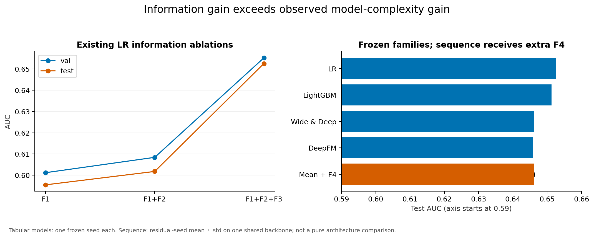
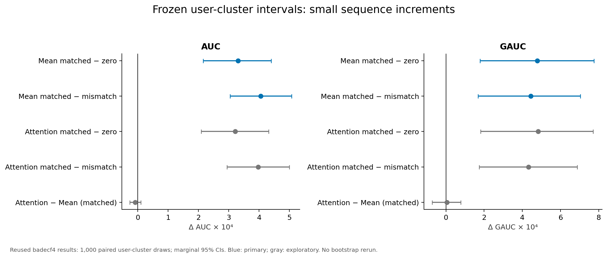
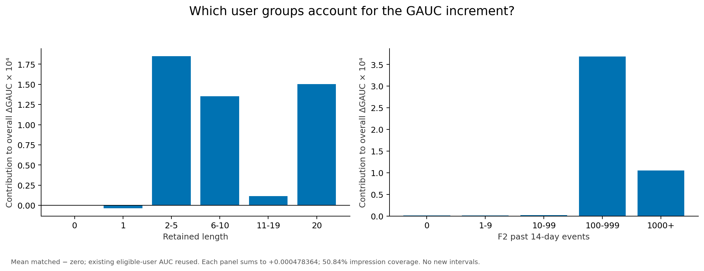
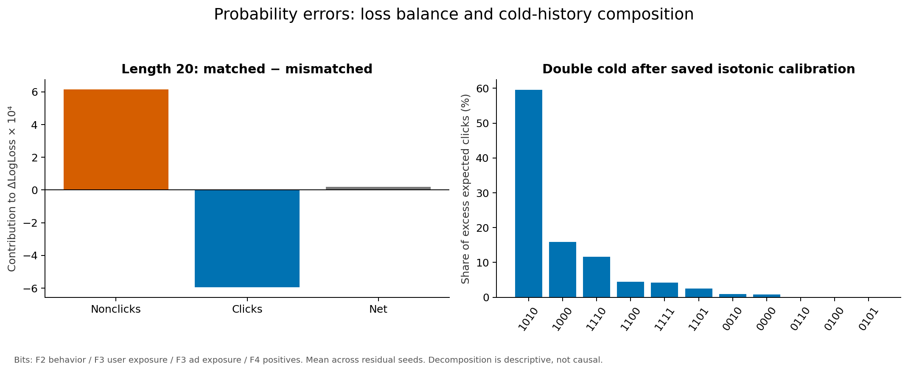
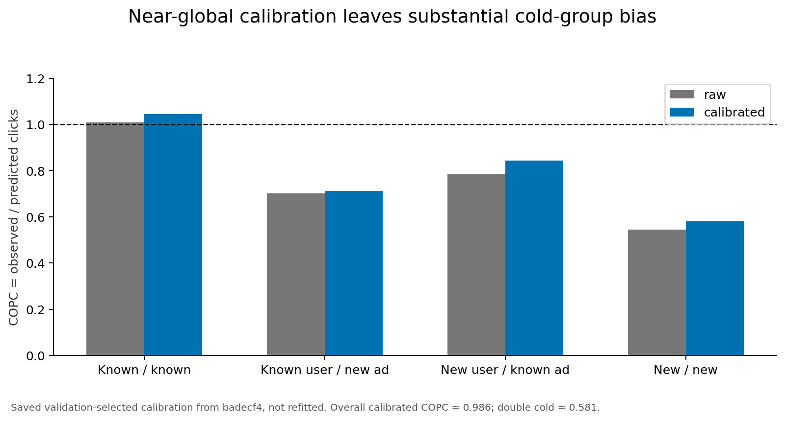
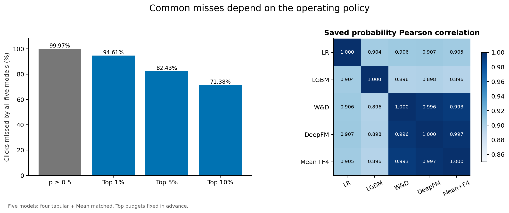
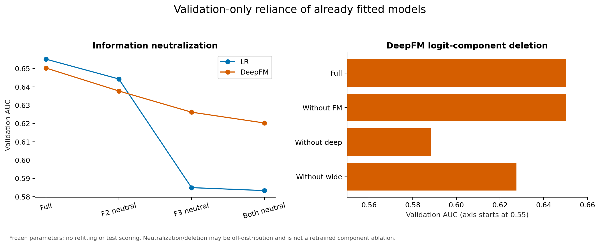
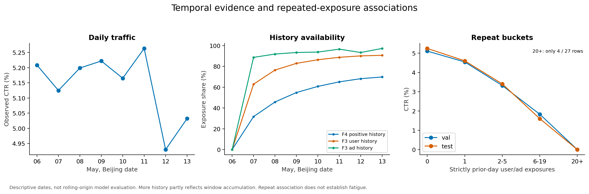

# 严格时间切分下的 CTR 预测
## 最终中文报告 · 冻结证据与发布审计

研究范围：淘宝展示广告 26,557,961 条曝光。

摘要：

- F3 已完成日点击反馈使 LR test AUC 提升 **+0.05070**（F12 0.601790 → F123 0.652489），F2 为 **+0.00630**。
- 相同 F123 预算下，冻结 LR 为 **0.652489**，DeepFM 为 **0.645933**。对已保存预测做配对用户 cluster bootstrap：LR − DeepFM AUC **+0.00655565**，95% CI [+0.00596489, +0.00721123]，Holm p = 0.001998。四个模型之间**所有 GAUC 差值的区间都含零**。
- **过去点击广告的 category** 序列（L=20，test 平均 4.69 个保留 token，30.21% 曝光为空历史）相对 zero 参照提升 AUC **+0.000330**，95% CI [+0.000216, +0.000440]。
- 在这种短而稀疏的点击 category 序列上，target attention 相对 mean pooling 没有稳定的排序优势（attention − mean AUC **−0.0000086**，区间含零）。
- Mean matched 校准后整体 COPC **0.986**，双冷启动 **0.581**，即预测点击约比实际点击**高 72%**。
- 新增 **F5** 预算改用 `behavior_log`（L=200），每条 test 曝光保留 **185.19** 个 token、空历史仅 **0.435%**。冻结 test 上相对 pipeline null 提升 **+0.00127246 AUC**，95% CI [+0.00104340, +0.00150052]，Holm p = 0.003996；相对 F4 点击来源提升 **+0.00094211 AUC**。其中约 **95%** 的增益是用户身份特有的。但**两项 GAUC 差值的区间都含零**。
- 在 F5 更丰富的序列源上，attention 首次与 mean pooling 分离（**+0.00023967 AUC**，区间排除零），但效应量约为身份效应的五分之一、约两个 seed 标准差；**mean matched 仍为预先选定的主模型**。
- F5 的代价是其所依附的 DeepFM backbone 的 **3.3 倍端到端吞吐** 与 **7.5 倍峰值内存**，换取这 +0.00127 AUC。

核心结论：在本项目的数据口径、信息层与调参预算下，高质量历史点击反馈带来的增益，大于所观察到的模型复杂度增益。用户匹配的**过去点击广告 category** 序列提供小幅增量；在该表示上 target attention 未显示优于简单均值聚合的稳健实际优势。**上述序列结论仅限于点击广告 category 这一来源，不推广到完整 `behavior_log` 的 pv/cart/fav/buy 行为序列，也不构成对序列建模或 DIN 的一般结论。** 序列模型未超过强全局 LR 基线，但用户内排序呈现不同结论。

| 数据分区 | 北京时间日期 | 曝光数 | 用途 |
|---|---|---:|---|
| Train | 2017-05-06 至 05-11 | 20,015,245 | 词表、标准化、训练 |
| Validation | 2017-05-12 | 3,234,051 | 配置与校准方法选择 |
| Test | 2017-05-13 | 3,308,665 | 冻结最终报告，166,490 次点击 |

指标方向：AUC、PR-AUC、GAUC 越高越好；LogLoss、Brier、ECE 越低越好。COPC = 实际点击数 / 预测点击数 = CTR / 平均预测；理想值为 1，小于 1 表示高估，大于 1 表示低估。COPC 增大本身不等于改善。COPC=0.581 表示预测点击比实际点击约**高 72%**（`1/0.581 − 1`）；它与「实际比预测少 42%」（`1 − 0.581`）是分母不同的两个量，不可混用。

GAUC 按用户曝光量加权，仅包括同时具有正负样本的用户：test 合格用户 104,884 个，覆盖 1,682,247 次曝光（50.84%）。来源：[R1–R3]。

<!-- pagebreak -->
# 00 · F5 行为序列预算与一次性正式 test

F5 是第二个序列来源，在正式 pass 之前已提交全部分析规则，仅执行一次推理。F4 保留平均 4.69 个点击广告 category token、30.21% 的 test 曝光为空；F5 保留 185.19 个 `behavior_log` token、空历史 0.435%。两者共用同一个冻结 DeepFM backbone。

| 条件 | Test AUC ± std | Test LogLoss ± std | Test GAUC ± std |
|---|---|---|---|
| F5 attention matched | 0.647445 ± 7.7e-5 | 0.193043 ± 2.9e-5 | 0.570476 ± 5.4e-5 |
| **F5 mean matched** | 0.647206 ± 6.0e-5 | 0.193061 ± 3.1e-5 | 0.570251 ± 2.4e-4 |
| F4 mean matched | 0.646263 ± 4.4e-5 | 0.193120 ± 4.0e-6 | 0.570380 ± 1.1e-4 |
| F5 mean mismatched | 0.646003 ± 1.3e-4 | 0.193153 ± 1.1e-5 | 0.569840 ± 6.3e-5 |
| zero pipeline null | 0.645933 ± 0 | 0.193176 ± 0 | 0.569902 ± 0 |

两个主比较在 Holm p = 0.003996 下都排除零：mean matched − zero AUC +0.00127246 CI [+0.00104340, +0.00150052]；mean matched − mismatched AUC +0.00120269 CI [+0.00098519, +0.00142260]。错配对照只捕获约 **5.5%** 的效应，说明增益来自用户身份本身，而非保留长度、粗活跃度、新近度或类目热门度。全部 12 组 AUC/LogLoss 配对在三个 seed 上方向一致。

三点限定。**全局与用户内排序不一致**：F5 在 AUC 上同时超过 null 和 F4，但对二者的 GAUC 区间都含零（p = 0.172 与 p = 0.621）。**增益落在稀疏来源为空的地方**：在 985,688 条没有点击历史的曝光上 F5 − zero 为 +0.001607，高于两边都有历史时的 +0.001163；而在**双冷启动上为负**（28,331 行，−0.001741，无区间）。**donor bucket relaxation 无关**：排除全部 1,457 行放宽样本后，matched − mismatched 在 AUC 上最多变化 9.0e-7，符号全部保持。

F5 将 LR F123（0.652489）与冻结 null 之间的全局 AUC 差距缩小约 **19.4%**，LR 仍领先约四倍于整个 F5 效应。GAUC 上次序反转：F5 为 0.570251，LR 为 0.569939——与冻结表格模型 bootstrap 一致（那里所有 GAUC 差值区间也都含零）。

校准沿用仅在 validation 选定的方法，13 个校准器全部选择 isotonic：mean matched 的 LogLoss 由 0.193061 降到 0.192755、ECE 由 0.004785 降到 0.000975、COPC 由 0.9478 升到 0.9866，AUC/GAUC 轻微下降（并列生成机制）。

详见 docs/F5_BEHAVIOR_VALIDATION.md、docs/F5_BEHAVIOR_TEST_RESULTS.md、docs/SERVING_BENCHMARK.md、docs/EXPERIMENT_INDEX.md。

<!-- pagebreak -->
# 01 · 最终实验清单与时间语义

| 阶段 | 已完成内容 | 证据与边界 |
|---|---|---|
| 数据与信息层 | F1 静态上下文；F2 行为统计；F3 历史反馈 | raw ID 先连接；词表与标准化仅由 train 拟合 |
| 四类表格模型 | LR、LightGBM、Wide & Deep、DeepFM | 各一个冻结 seed 42；不补做独立 backbone 多种子 |
| F4 序列机制实验 | mean / attention × matched / mismatched | 三个残差 seed：42、2026、3407；共享一个冻结 DeepFM |
| 零序列参照 | 同管线硬零表示 | 一个确定性预测器；三次引用不等于三个独立模型 |
| 统计与校准 | 五组比较；1,000 次用户 cluster bootstrap；13 个校准器 | 已完成并冻结于 badecf4；本次不重算、不重拟合 |
| D2 / D3 / D4 | 保存预测的分组诊断 / validation 敏感性 / 描述性时序 | 无新正式模型，无新 test 推理 |
| D5 / release | 统一报告、八幅图、数值与交付审计 | 只整理冻结证据；项目扩展停止 |

行为日志的有效窗口为 2017-04-22 至 05-13 共 22 天，承载全部事件的 99.9786%；更早的时间戳零散或损坏（653 个日期共 127,136 条），因此 05-06 之前的有效历史为 14 个完整日。F3 在训练首日 05-06 没有窗口内的已完成前日，全部实体历史退化为固定 prior 且 `has_past_feedback = 0`；这 3,270,348 条曝光（训练集 16.3%）**予以保留，未被删除**。

F4 是过去正点击广告的 category 有序序列，初始及冻结长度 L=20。曝光日 D 只使用北京时间日期严格小于 D 的正点击记录，不使用同日点击。曝光 timestamp 是正点击记录时间的代理，假设反馈次日可用；数据没有独立点击发生时间。Validation 不含 05-12 点击，test 可以使用已经结束的 05-12 点击。

序列词表只由 train 建立；PAD=0、UNKNOWN=1 为中性零向量，空历史得到严格零序列表示。错配以 cutoff、保留长度和过去活跃度分桶确定性置换，seed=20260926。序列残差配置 LR=5e-4、batch=4096、L=20、epoch=1；原 backbone 不重训。来源：[R1–R3]。

<!-- pagebreak -->
# 02 · 信息增益与模型复杂度

表 1｜原始 test 指标。序列行是三个残差 seed 的均值 ± 样本标准差（ddof=1），不是概率平均集成；其余为单个冻结 seed。

| 模型 / 信息层 | AUC ↑ | LogLoss ↓ | GAUC ↑ |
|---|---:|---:|---:|
| LR F1 | 0.595495 | 0.196781 | 0.561913 |
| LR F12 | 0.601790 | 0.196376 | 0.561534 |
| LR F123 | 0.652489 | 0.192429 | 0.569939 |
| LightGBM F123 | 0.651318 | 0.192502 | 0.569889 |
| Wide & Deep F123 | 0.646219 | 0.193161 | 0.569680 |
| DeepFM F123 / zero | 0.645933 | 0.193176 | 0.569902 |
| Mean matched F123+F4 | 0.646263 ± 0.000044 | 0.193120 ± 0.000004 | 0.570380 ± 0.000108 |

F3 的 LR AUC 增量约 0.05070，F2 约 0.00630。原 LR 选择 epoch 分别为 3、3、2；不能解释为完全相同固定 epoch 的因果对照。

对已保存 test 预测的配对用户 cluster bootstrap（1,000 次，seed 20260926，协议预先提交于 29659c3）为表格模型排序给出区间：

| 比较 | 指标 | 点估计 | 95% CI | 区间是否排除零 |
|---|---|---:|---|:--:|
| LR − DeepFM（主） | AUC | +0.00655565 | [+0.00596489, +0.00721123] | 是 |
| LR − DeepFM（主） | LogLoss | −0.00074793 | [−0.00083617, −0.00067152] | 是 |
| LR − LightGBM | AUC | +0.00117059 | [+0.00059116, +0.00173101] | 是 |
| LR − LightGBM | LogLoss | −0.00007366 | [−0.00014903, +0.00000767] | **否** |
| LR − LightGBM | GAUC | +0.00004970 | [−0.00124507, +0.00127498] | **否** |
| LR − Wide & Deep | GAUC | +0.00025893 | [−0.00079951, +0.00140635] | **否** |

Holm 只覆盖两个主指标（均为 p = 0.001998）。区间以四个冻结模型与这一个 test 日为条件，刻画**用户抽样**不确定性，**不是**训练 seed 不确定性——每个表格模型只有一个 seed。两点对叙述重要：LR 的全局排序优势在用户重抽样下稳定，而**所有 GAUC 差值区间都含零**，说明该优势没有转化为用户内排序优势；LR 相对 LightGBM 是排序差异，不是概率质量差异。来源：[R2、R3、R7]、docs/FROZEN_MODEL_BOOTSTRAP.md。

<!-- pagebreak -->
# 03 · 五组预先冻结比较

表 2｜左模型减右模型。AUC 为正、LogLoss 为负代表左侧较好；secondary 仅为机制性／探索性比较。

| 顺序 | 冻结比较 | ΔAUC | ΔLogLoss |
|---|---|---:|---:|
| Primary 1 | Mean matched − zero | +0.000330347 | −0.000056164 |
| Primary 2 | Mean matched − mean mismatched | +0.000405708 | −0.000030542 |
| Secondary 3 | Attention matched − zero | +0.000321725 | −0.000058000 |
| Secondary 4 | Attention matched − attention mismatched | +0.000397302 | −0.000032132 |
| Secondary 5 | Attention matched − Mean matched | −0.000008622 | −0.000001836 |

原 bootstrap seed=20260927，共 1,000 次有效重复；整用户曝光一起抽样。两个 primary 的 AUC/LogLoss 在联合四假设 Holm 下 p=0.003996。三个残差 seed 的 matched−mismatched 在四项指标上方向一致。区间是给定模型与日期的数据抽样不确定性，seed 标准差是固定 backbone 下的训练随机性；两者不同。来源：[R1、R2]。

<!-- pagebreak -->
# 04 · 增量很小，用户内排序与全局排序不同

Mean matched − zero 的 ΔAUC=+0.000330347，已有 95% CI 为 [+0.000215737, +0.000440027]。Mean matched − mismatched 的 ΔAUC=+0.000405708，已有 CI 为 [+0.000304701, +0.000507655]。它们分别约为 0.0330 和 0.0406 个 AUC 百分点；LogLoss 相对改善仅约 0.0291% 和 0.0158%。统计可检测不等于实际增益很大。

Attention − mean 的 AUC、PR-AUC、GAUC 区间含零；LogLoss 百分位区间略低于零，但预先定义的 centered p=0.064935。两种统计量并非互为反演，原样保留，不能择优引用。Mean 仍为主要序列模型。

约 98.89% 的 GAUC 增量来自已知用户；长度 2–5、6–10、20 贡献主要增益，长度 1 略为负，空历史严格为零。活跃度 100–999 和 1000+ 分别贡献约 77.02%、22.05%。但所有固定活跃度分桶的全局 AUC 仍是 LR 更高；这些是描述性分解，没有新增分组显著性检验。来源：[R1、R4]。

<!-- pagebreak -->
# 05 · 长历史：为何 AUC 改善而 LogLoss 恶化

在保留长度 20 的组中，Mean matched − mismatched 的 ΔAUC=+0.000474273，ΔLogLoss=+0.000019789。排序改善与概率误差变差可以同时成立：非点击样本增加的损失约 +0.000615，略超过点击样本改善的约 −0.000595。原始历史长度 ≥50 的样本贡献了净损失恶化的 58.64%。

“20”表示达到截断上限，包含原始长度等于及大于 20。上述分解解释损失的加总关系，并不识别截断的因果效果；该组 matched 相对 zero 的 LogLoss 仍更好。

右图四位证据码依次表示：F2 行为、F3 用户曝光、F3 广告曝光、F4 正点击历史是否存在。1010 组贡献约 59.54% 的过量预测；0000 组只贡献约 0.82%。用户／广告不在 train 词表，仍可能具有随后积累的历史证据，“冷启动”不等于“完全空历史”。来源：[R4]。

<!-- pagebreak -->
# 06 · 全局校准改善，不代表冷启动偏差消失

校准只在 validation 拟合与选择：按 impression_id 哈希进行约 80% 拟合、20% 方法选择，再在完整 validation 重拟合所选方法。四个序列条件各三个 seed、zero 一次，共 13 个校准器，均选择 isotonic。完整 validation 上的校准后指标属于拟合内指标，不是独立验证。

Mean matched 的 test 校准后 LogLoss=0.192839887、ECE=0.001043477、COPC=0.986346；双冷启动 COPC 却只有约 0.581043，对应 28,331 条曝光中 1,024 次点击，而预测约 1,762 次。已知用户／已知广告组 COPC 从约 1.009267 升到 1.043399，偏差方向与改善程度并不一致。

全部 13 个预测器的整体 LogLoss/ECE 改善，但 AUC、PR-AUC、GAUC 均下降；isotonic 引入的并列可改变排序指标。共享 evaluator 的 ECE 为 10 个等频箱；校准选择历史辅助输出采用 20 个等宽箱，不能混作同一指标口径。未使用 test 决定是否保留校准器。来源：[R1、R4]。

<!-- pagebreak -->
# 07 · 共同漏报与模型互补性的审计

五模型是 LR、LightGBM、Wide & Deep、DeepFM 和 Mean matched。在每个模型各自 top-10% 曝光预算下，71.38% 的真实点击被五者共同漏掉；分母为全部 test 点击，而不是全部曝光。使用 probability≥0.5 时，共同漏报约 99.97%，不能混用这两种操作策略。

旧“60%”代码本来采用 top-10% 分位阈值，并非 probability≥0.5。旧预测数组缺失，且旧脚本会跳过缺失模型、缺少 ID 对齐断言，因此无法精确复现旧 60%；不能将其与重建后的 330.9 万 test 曝光结果合并。

每模型 top-10% 集合的并集覆盖 14.61% 曝光、召回 28.62% 点击，不是相同预算下的集成收益。Mean matched 与 DeepFM 的概率 Pearson 约 0.99734。使用真实标签逐行挑选最低损失的 oracle LogLoss 约 0.178235，是不可部署的乐观界，不是已实现的集成效果。来源：[R4、R8]。

<!-- pagebreak -->
# 08 · 冻结组件删除：敏感性诊断

D3 仅使用 05-12 validation。Frozen component deletion 明确属于 sensitivity diagnostic（敏感性诊断），不是 retrained ablation（重新训练的消融）。参数保持固定，特征中和或 logit 分支删除可能造成分布外输入；不能将剩余分支当作独立训练的模型。

LR 的 validation AUC：完整 0.655163，中和 F2 为 0.644353，中和 F3 为 0.584946；DeepFM 对应 0.650315、0.637786、0.626190。两者均更依赖已有 F3。

删除 DeepFM 的 FM 项后 AUC 仅从 0.650315 变为 0.650292，而 LogLoss 从 0.189813 变为 0.190702，说明排序与概率水平变化不能互相替代。LR 的 F2 加性项在同一 validation 日的同用户内恒定，因此删除 F2 可改变全局 AUC，而不改变用户内排序。现有 epoch 曲线记录过拟合迹象，但不能证明模型复杂度普遍有害。来源：[R5]。

<!-- pagebreak -->
# 09 · 时间漂移与重复曝光：描述性关联

时间漂移与重复曝光结果均为描述性关联，不是因果估计。05-11、05-12、05-13 的 CTR 分别为 5.2633%、4.9299%、5.0319%，变化并不单调。Validation 到 test 的新用户占比从约 9.94% 升至 11.70%，新广告从 6.71% 升至 8.77%。

历史广告证据覆盖从 93.29% 升至 97.22%，部分来自可观测窗口累积。三日滚动表只描述流量，并未执行 rolling-origin 模型评估，也没有把训练期预测当成 held-out 预测。

test 的历史 user/ad 重复曝光桶 0、1、2–5、6–19 的 CTR 约为 5.24%、4.60%、3.40%、1.60%。≥20 桶只有 27 条曝光且无点击，AUC 不可定义。曝光选择、幸存者偏差与左截断均存在，因此不能把较低 CTR 直接解释为广告疲劳。只有两个 held-out 日期，不支持稳定的跨时期泛化定律。来源：[R6]。

<!-- pagebreak -->
# 10 · 结论层次与证据限制

| 问题 | 当前证据允许的结论 | 不允许的延伸 |
|---|---|---|
| 历史信息是否重要 | LR 信息层结果与冻结敏感性均支持 F3 的主要贡献 | 不能声称对所有模型与数据均成立 |
| matched 是否优于 mismatched | 五组冻结比较中的匹配收益小且可统计检测 | 不能解释为完全控制所有热门度／活跃度混杂 |
| 序列是否超越 zero | 对冻结 backbone 有小幅 AUC、LogLoss、GAUC 增益 | 不能声称三次独立 backbone 重训获胜 |
| attention 是否超越 mean | 在点击 category 序列上无稳健实际优势；mean 仍为主要序列模型 | 不因 test 结果更换优先级；不推广到 behavior_log 序列 |
| 序列结论的适用范围 | F4 覆盖点击广告 category（平均 4.69 token）；F5 覆盖 behavior_log（平均 185.19 token） | 不能读作对序列建模或 DIN 的一般否定 |
| F5 是否超过 F4 | 全局 AUC 上超过（+0.00094211，区间排除零） | 用户内排序（GAUC）未超过，区间含零 |
| F5 增益是否值得部署 | 在本实现下不值得：3.3 倍吞吐成本、7.5 倍内存换 +0.00127 AUC | 不能推广到会分页缓存窗口的生产特征存储 |
| 全局与用户内排序 | LR 全局强；Mean matched 的 GAUC 较高 | 不新增未冻结的显著性比较 |
| 校准与分组误差 | 整体概率误差改善，但双冷启动偏差保留 | 不声称分组校准已被验证有效 |

Test 在早期基线开发中已经被查看，后来才冻结，不是从未触碰的 holdout。bootstrap 与深挖方案是在已知整体 test 结果后、对应新分组结果前固定，不能追称为最初预注册。校准实际采用 impression-level 80/20，而非历史提案的 user-grouped OOF，偏离须保留。需要准确表述的是：校准器只接收预测概率与标签，从不接收 `user_raw`，因此**不构成校准器记住用户标签**的泄漏。真实局限是样本依赖——同一用户的曝光并非独立，按 impression 切分使拟合集与选择集相关，可能低估**方法选择**的不确定性。若要评估对全新用户的校准泛化，user-grouped 切分才是合适设计。

各表格模型只有一个 seed；三个序列 seed 只刻画共享冻结 backbone 下的残差随机性。未完成 LightGBM F1/F12、独立训练 FM/DNN 消融、三套独立表格 backbone 或公平独立吞吐基准。已有混合批量推理时间不能冒充各模型独立速度比较。

冻结证据仍为 badecf4 及 DIN_F4_TEST_RESULTS.md。所有新增交付仅为已有数字的核验与呈现，不增加训练、推理、统计检验或 post-hoc 分析。来源：[R1、R7]。

<!-- pagebreak -->
# 11 · 复现入口与仓库内引用

从仓库根目录执行只读交付检查：python src/37_verify_frozen_delivery.py；python src/38_release_audit.py。完整合成数据测试：python -m unittest discover -s tests -v；格式检查：git diff --check。这些不是重跑实验的命令。

核心依赖与已测版本分别见 requirements.txt、requirements-tested.txt；图表环境见 requirements-plot.txt；中文 PDF 排版环境见 requirements-report.txt。PDF 排版与 CTR 环境隔离。生成命令、字体参数及数据目录说明见 docs/RELEASE_AUDIT.md。

| 引用 | 仓库内可定位证据（路径相对仓库根目录） |
|---|---|
| [R1] | docs/DIN_F4_TEST_RESULTS.md；results/sequence_posthoc_v1/ |
| [R2] | results/sequence_selection_v2/；results/sequence_test_v2/ |
| [R3] | results/lr_f1*/；results/lightgbm_f1_f2_f3/；results/wide_deep_f1_f2_f3/；results/deepfm_f1_f2_f3/ |
| [R4] | docs/DEEP_DIVE_D2_RESULTS.md；results/deep_dive_d2_v1/ |
| [R5] | docs/DEEP_DIVE_D3_RESULTS.md；results/deep_dive_d3_v1/ |
| [R6] | docs/DEEP_DIVE_D4_RESULTS.md；results/deep_dive_d4_v1/ |
| [R7] | docs/FINAL_REPORT.md；docs/DEEP_DIVE_RESEARCH_PLAN.md |
| [R8] | results/deep_dive_final_v1/legacy_notebook_corroboration.json；archive/v1-original 分支 |

图 1–8 来自 figures/deep_dive_v1/ 已有八幅图（按本报告叙事重排），来源哈希见 results/deep_dive_final_v1/figure_manifest.json。图内沿用英文变量名，中文图题说明分母、方向和解释边界，未重绘或修改实验数值。

大型原始数据、模型、预测与中间表保存在本地 Git-ignored 目录，没有被小型 manifest 备份。缺少这些本地产物时只能核对已提交的汇总，不能声称完整重现实验。最终审计、逐页检查与测试日志位于 results/release_audit_v1/。项目在本次 release 后停止扩展。
